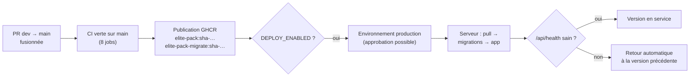

# Déploiement en production (CD)

La chaîne de livraison part d’une PR fusionnée et va jusqu’à une version en service, vérifiée et réversible. Elle réutilise l’image Docker déjà construite et testée par la CI.

## Vue d’ensemble



| Étape | Où | Automatique |
| --- | --- | --- |
| Lint, types, tests unitaires, PostgreSQL, E2E, build, image | `.github/workflows/ci.yml` | Oui, sur chaque PR et chaque push |
| Publication des images `ghcr.io/kuro250104/elite-pack` et `…-migrate` (étiquettes `sha-<commit>`, version, `latest`) | `.github/workflows/cd.yml`, job **Publication des images** | Oui, après une CI réussie sur `main` |
| Déploiement sur le serveur | `.github/workflows/cd.yml`, job **Déploiement en production** | Oui, dès que l’administrateur l’active |
| Migrations, remplacement de l’application, contrôle de santé, retour arrière | [`deploy/deploy.sh`](../deploy/deploy.sh), exécuté sur le serveur | Oui |

Une version n’est jamais publiée si la CI a échoué : le workflow de CD démarre **après** la fin de la CI (`workflow_run`), et seulement en cas de succès.

## Réduire l’indisponibilité

| Mesure | Effet |
| --- | --- |
| Images construites **avant** le déploiement, puis téléchargées (`docker compose pull`) | Le serveur ne compile rien pendant la mise en production |
| Migrations **additives** uniquement (colonnes et tables ajoutées, jamais supprimées dans la même version) | Elles s’appliquent pendant que l’ancienne version tourne encore ; le code ne change qu’après |
| Base et proxy jamais redémarrés pour une nouvelle version (`--no-deps`) | Seul le conteneur applicatif est remplacé |
| Attente de la sonde `/api/health` (`docker compose up --wait`) | La version n’est déclarée en service que si elle répond et joint la base |
| Caddy vérifie aussi `/api/health` | Le trafic n’est envoyé qu’à une application saine |
| Retour automatique à l’étiquette précédente (`.deployed-tag`) | Une version défaillante ne reste pas en ligne |

Sur un seul serveur, le remplacement du conteneur coupe le service **quelques secondes**. Pour supprimer cette coupure, l’infrastructure « heavy » lance plusieurs instances derrière un répartiteur de charge et les remplace une par une (rolling update ou blue/green).

Une suppression de colonne se fait en deux versions : la première cesse d’utiliser la colonne, la seconde la supprime.

## Infrastructure « light » : un serveur Docker

[`deploy/compose.prod.yaml`](../deploy/compose.prod.yaml) décrit la production sur un VPS Docker (par exemple OVH, environ 5 à 10 € par mois) :

```text
Internet ──443──▶ caddy (HTTPS Let's Encrypt) ──▶ app (Next.js, non root, 1 CPU / 768 Mo) ──▶ postgres (volume persistant)
```

Chaque service a une sonde de santé, une politique de redémarrage et des limites de ressources. Les secrets restent dans `/opt/elite-pack/.env` **sur le serveur** : ils ne transitent ni par le dépôt ni par GitHub.

## Mise en service : à faire une seule fois

### Sur le serveur

```sh
# Docker et Compose installés ; utilisateur de déploiement dans le groupe docker.
sudo mkdir -p /opt/elite-pack && sudo chown deploy:deploy /opt/elite-pack
# Copier deploy/.env.production.example vers /opt/elite-pack/.env, le compléter, puis :
chmod 600 /opt/elite-pack/.env
# Si les images GHCR sont privées : jeton GitHub limité à read:packages.
echo "$JETON" | docker login ghcr.io -u <compte> --password-stdin
```

Le domaine choisi (`DOMAIN`) doit pointer vers l’IP du serveur (enregistrement DNS A).

### Dans GitHub (administrateur du dépôt)

| Réglage | Type | Valeur |
| --- | --- | --- |
| Environnement `production` | Settings → Environments | Branche autorisée : `main` ; approbateurs requis si souhaité |
| `DEPLOY_ENABLED` | Variable | `true` pour activer le déploiement |
| `PRODUCTION_URL` | Variable | `https://<domaine>` |
| `DEPLOY_PATH` | Variable (facultative) | `/opt/elite-pack` par défaut |
| `DEPLOY_HOST`, `DEPLOY_USER` | Secrets de l’environnement | Adresse du serveur, utilisateur de déploiement |
| `DEPLOY_SSH_KEY` | Secret de l’environnement | Clé privée dédiée au déploiement (clé publique dans `~/.ssh/authorized_keys` du serveur) |
| `DEPLOY_KNOWN_HOSTS` | Secret de l’environnement | Résultat de `ssh-keyscan <serveur>` (empreinte vérifiée, pas de connexion à l’aveugle) |

Tant que `DEPLOY_ENABLED` n’est pas à `true`, le CD publie les images et s’arrête : aucune erreur, aucun accès au serveur.

## Livrer une version

1. Fusionner les PR dans `dev`, puis ouvrir et fusionner la PR de promotion `dev` → `main`.
2. La CI tourne sur `main` ; si elle réussit, le CD publie les images.
3. Si le déploiement est activé, l’environnement `production` demande l’approbation (si elle est configurée), puis déploie et vérifie `/api/health`.
4. Le résumé du workflow liste les images publiées ; l’onglet **Environments** du dépôt montre la version en production.

Livraison manuelle d’un commit ou d’un tag : Actions → **Livraison et déploiement** → *Run workflow*.

## Revenir en arrière

Automatique si la nouvelle version n’est pas saine. À la main, sur le serveur, avec n’importe quelle étiquette déjà publiée :

```sh
cd /opt/elite-pack
IMAGE=ghcr.io/kuro250104/elite-pack TAG=sha-<commit-précédent> ./deploy.sh
```

Les migrations étant additives, l’ancienne version fonctionne avec le schéma le plus récent.

## Exploitation

| Besoin | Commande sur le serveur |
| --- | --- |
| Version en service | `cat /opt/elite-pack/.deployed-tag` |
| État et santé | `docker compose -f compose.prod.yaml ps` |
| Journaux (JSON) | `docker compose -f compose.prod.yaml logs -f app` |
| Retrouver une erreur signalée | `docker compose -f compose.prod.yaml logs app \| grep <référence>` ([gestion des erreurs](errors.md)) |
| Sauvegarde de la base | `docker compose -f compose.prod.yaml exec postgres pg_dump -U elite_pack elite_pack > sauvegarde.sql` (à planifier chaque jour) |
