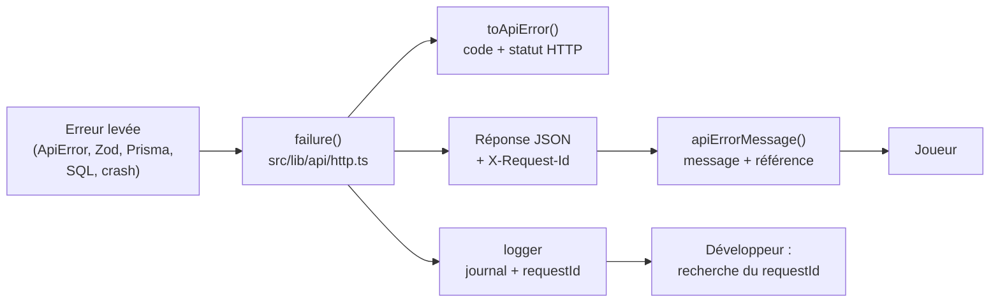

# Gestion des erreurs

Stratégie commune au frontend et au backend, définie dans [SCRUM-86](https://lemeurvincent31.atlassian.net/browse/SCRUM-86) et [SCRUM-87](https://lemeurvincent31.atlassian.net/browse/SCRUM-87). Deux objectifs :

- **le joueur** comprend ce qui s’est passé, en français, et sait quoi faire ;
- **le développeur** retrouve la cause exacte grâce à un identifiant, sans que la production expose de détail technique.

## Sommaire

1. [Le parcours d’une erreur](#1-le-parcours-dune-erreur)
2. [Contrat d’erreur de l’API](#2-contrat-derreur-de-lapi)
3. [Catalogue des erreurs](#3-catalogue-des-erreurs)
4. [Mode développement et mode production](#4-mode-développement-et-mode-production)
5. [Journalisation](#5-journalisation)
6. [Côté interface](#6-côté-interface)
7. [Démonstration](#7-démonstration)
8. [Tests](#8-tests)

---

## 1. Le parcours d’une erreur



Toutes les routes API passent par `failure()`. Les erreurs qui n’y passent pas, comme le rendu d’un composant serveur, sont captées par `src/instrumentation.ts` (`onRequestError`) et par les pages `error.tsx` et `global-error.tsx`.

## 2. Contrat d’erreur de l’API

```http
HTTP/1.1 409 Conflict
Content-Type: application/json
Cache-Control: no-store
X-Request-Id: 3f0c2a9e-6b1d-4e7a-9c55-0d2f6a1b8e41

{
  "error": {
    "code": "LISTING_ALREADY_SOLD",
    "message": "Cette carte vient d’être vendue.",
    "requestId": "3f0c2a9e-6b1d-4e7a-9c55-0d2f6a1b8e41"
  }
}
```

| Champ | Toujours présent | Rôle |
| --- | --- | --- |
| `code` | Oui | Identifiant stable en anglais, utilisé par le code client |
| `message` | Oui | Message en français, affichable tel quel |
| `requestId` | Oui | Identique à l’en-tête `X-Request-Id` ; permet de retrouver l’erreur dans les journaux |
| `fields` | Si besoin | Erreurs par champ de formulaire (inscription) |
| `debug` | **Développement uniquement** | Nom, message, code et premières lignes de la pile de l’erreur d’origine |

Une erreur 429 ou 503 ajoute l’en-tête `Retry-After`. Le contrat est aussi décrit dans Swagger UI (`/api-docs`), schéma `ErrorEnvelope`.

## 3. Catalogue des erreurs

La conversion est faite par `toApiError()` dans [`src/lib/api/error-mapping.ts`](../src/lib/api/error-mapping.ts).

| Origine | Statut | Code | Ce que voit le joueur |
| --- | ---: | --- | --- |
| Validation Zod, JSON invalide | 400 | `INVALID_INPUT`, `INVALID_JSON` | « Les données saisies sont invalides. » ; champs en erreur pour l’inscription |
| Session absente ou expirée | 401 | `UNAUTHENTICATED` | « Veuillez vous connecter. » |
| Rôle insuffisant, origine refusée | 403 | `FORBIDDEN`, `INVALID_ORIGIN` | Action refusée |
| Enregistrement absent (Prisma `P2025`) | 404 | `NOT_FOUND` | « Cette ressource est introuvable. » |
| Doublon (Prisma `P2002`) ou dépendance (`P2003`) | 409 | `CONFLICT` | La ressource existe déjà ou est utilisée |
| Transaction concurrente (Prisma `P2034`, PostgreSQL `40001`, `40P01`) | 409 | `CONCURRENT_UPDATE` | « Une autre opération est en cours sur ces données. Réessayez. » |
| Règle métier (stock, solde, annonce…) | 409 | `INSUFFICIENT_FUNDS`, `BOOSTER_STOCK_EMPTY`, `LISTING_SOLD`… | Message métier précis |
| Corps trop gros, pas du JSON | 413, 415 | `PAYLOAD_TOO_LARGE`, `INVALID_CONTENT_TYPE` | Message explicite |
| Trop de requêtes | 429 | `RATE_LIMITED` | Délai d’attente (`Retry-After`) |
| Erreur SQL inattendue, crash du code | 500 | `INTERNAL_ERROR` | « Le service est temporairement indisponible. » + référence |
| Fournisseur TheSportsDB en erreur | 502 | `PROVIDER_ERROR`, `INVALID_PROVIDER_RESPONSE` | Import impossible pour l’instant |
| Base injoignable (`ECONNREFUSED`, Prisma `P1001`, `P1017`, `P2024`…) | 503 | `SERVICE_UNAVAILABLE` | « Réessayez dans quelques instants. » (`Retry-After: 5`) |

Codes métier en usage, par statut :

| Statut | Codes |
| ---: | --- |
| 400 | `IMAGE_RIGHTS_INCOMPLETE`, `INVALID_DATES`, `INVALID_EDITIONS`, `INVALID_INPUT`, `INVALID_JSON`, `INVALID_OPENING`, `INVALID_REGISTRATION`, `INVALID_SPORTS`, `INVALID_USER`, `TRANSLATION_REQUIRED` |
| 404 | `ATHLETE_NOT_FOUND`, `CARD_NOT_OWNED`, `EDITION_NOT_FOUND`, `IMAGE_NOT_FOUND`, `LISTING_NOT_FOUND`, `NOT_FOUND`, `PLAYER_NOT_FOUND`, `SPORT_NOT_FOUND`, `USER_NOT_FOUND`, `WISHLIST_ITEM_NOT_FOUND` |
| 409 | `BOOSTER_CONFIGURATION_INVALID`, `BOOSTER_POOL_UNAVAILABLE`, `BOOSTER_STOCK_EMPTY`, `BOOSTER_UNAVAILABLE`, `CARD_ALREADY_LISTED`, `CARD_LISTED`, `CONCURRENT_UPDATE`, `CONFLICT`, `EDITION_MINTED`, `EDITION_UNAVAILABLE`, `EMAIL_TAKEN`, `EVENT_UNAVAILABLE`, `GAME_NOT_READY`, `IDEMPOTENCY_CONFLICT`, `IDENTITY_CONFLICT`, `IDENTITY_REVIEW_REQUIRED`, `IMAGE_VERSION_CONFLICT`, `INSUFFICIENT_FUNDS`, `LISTING_ALREADY_SOLD`, `LISTING_SOLD`, `LISTING_UNAVAILABLE`, `NO_PASSIVE_BOOSTER`, `NO_RESALE_VALUE`, `OPENING_KEY_CONFLICT`, `OWN_LISTING`, `PASSIVE_BOOSTER_NOT_ALLOWED`, `SPORT_MAPPING_REQUIRED`, `SPORT_UNAVAILABLE`, `SUPPLY_MODE_LOCKED`, `WALLET_NOT_FOUND` |
| 422 | `WISHLIST_FULL` |
| 503 | `GAME_NOT_CONFIGURED`, `INVALID_GAME_CONFIGURATION`, `INVALID_PASSIVE_STATE`, `PROVIDER_NOT_CONFIGURED`, `SERVICE_UNAVAILABLE`, `SYNC_NOT_CONFIGURED` |

**Ajouter une erreur métier** : lever `new ApiError("CODE_STABLE", "Message en français.", statut)` dans le service, jamais dans le composant. `failure()` s’occupe du reste.

## 4. Mode développement et mode production

Le mode suit `NODE_ENV` : `npm run dev` est en développement ; `npm run build && npm start`, l’image Docker et Vercel sont en production.

| | Développement | Production |
| --- | --- | --- |
| Réponse d’API | Message français **et** champ `debug` (erreur d’origine, code Prisma, pile) | Message français uniquement, **aucun** détail technique |
| Page d’erreur (`error.tsx`) | Message d’origine affiché en encadré | Message générique et référence (`digest`) |
| Journaux | Lignes lisibles, pile complète sur plusieurs lignes | Une ligne JSON par événement, prête pour un collecteur |
| Niveau par défaut | `debug` | `info` (`LOG_LEVEL` pour le changer) |
| Secrets (mots de passe, URL de base, jetons, cookies) | Masqués | Masqués |
| Documentation API et démo des erreurs | Disponibles | Désactivées, sauf `API_DOCS_ENABLED=true` et `ERROR_DEMO_ENABLED=true` |

## 5. Journalisation

Le logger [`src/lib/logger.ts`](../src/lib/logger.ts) n’ajoute aucune dépendance.

- **Erreur 5xx** : niveau `error`, avec `requestId`, `status`, `code` et l’erreur d’origine complète (nom, message, code, chaîne des causes, pile).
- **Refus attendu (4xx)** : niveau `info`, avec `requestId`, `status` et `code` seulement.
- **Crash hors API** (rendu serveur) : niveau `error` via `onRequestError`, avec la route, la méthode et le `digest` affiché au joueur.
- **Auth.js** : seul le type d’erreur est journalisé, jamais les identifiants.

Exemple en production :

```json
{"time":"2026-11-20T10:42:07.512Z","level":"error","message":"Erreur serveur","requestId":"3f0c2a9e-6b1d-4e7a-9c55-0d2f6a1b8e41","status":503,"code":"SERVICE_UNAVAILABLE","error":{"name":"PrismaClientKnownRequestError","message":"Can't reach database server at postgres:5432","code":"P1001"}}
```

### Retrouver une erreur signalée par un joueur

Le joueur voit « … (référence 3f0c2a9e) ». Il suffit de chercher ce préfixe dans les journaux :

| Environnement | Commande |
| --- | --- |
| Développement | Dans le terminal de `npm run dev` |
| Conteneurs | `docker compose -p elite-pack-foundation logs app \| grep 3f0c2a9e` |
| Erreur de page (digest) | Chercher le `digest` affiché sur la page d’erreur |

## 6. Côté interface

| Cas | Traitement | Fichier |
| --- | --- | --- |
| Appel d’API en erreur | Message de l’API ; pour une 5xx, ajout de la référence courte | [`src/lib/api/client-errors.ts`](../src/lib/api/client-errors.ts) (`apiErrorMessage`), utilisé par tous les formulaires et actions |
| Formulaire invalide | Erreur sous chaque champ (`fields`), `aria-invalid` et `aria-describedby` | `src/components/auth/register-form.tsx` |
| Réseau coupé | Message « Connexion interrompue », opération rejouable sans double débit (`Idempotency-Key`) | Formulaires d’administration, banque, marché, boosters |
| Plantage JavaScript ou d’un composant serveur | Page « Une erreur est survenue », bouton « Réessayer », référence | [`src/app/error.tsx`](../src/app/error.tsx) |
| Plantage du layout racine | Document de secours autonome, thème sombre | [`src/app/global-error.tsx`](../src/app/global-error.tsx) |
| Page inexistante | Page 404 en français avec retour à l’accueil | [`src/app/not-found.tsx`](../src/app/not-found.tsx) |
| Base indisponible | `/api/health` en 503 ; healthcheck Docker en échec | [`src/app/api/health/route.ts`](../src/app/api/health/route.ts) |

## 7. Démonstration

La page **`/demo/erreurs`** déclenche de vraies erreurs. Elle est disponible en développement, et en production seulement avec `ERROR_DEMO_ENABLED=true`.

| Démo | Action | Résultat attendu |
| --- | --- | --- |
| Erreur d’API (400, 401, 403, 409) | Boutons de la section 1 | Message français, statut, code et `X-Request-Id` affichés |
| Erreur ORM | « Enregistrement absent (erreur Prisma) » | Vraie erreur Prisma `P2025` traduite en 404 |
| Erreur SQL | « Requête SQL invalide » | 500 : détail SQL dans `debug` en développement, absent en production |
| Crash serveur | « Plantage du code serveur » | 500 et pile complète dans les journaux |
| Crash JavaScript | « Plantage JavaScript » | Page d’erreur avec « Réessayer » |
| Crash d’un composant serveur | « Plantage d’un composant serveur » | Page d’erreur avec référence ; journal `Erreur non gérée côté serveur` |
| 404 | « Page inexistante » | Page 404 française |
| Base coupée | `docker compose -p elite-pack-foundation stop postgres`, puis `/api/health` | 503 sans détail ; `ECONNREFUSED` ou `P1001` dans les journaux |

**Comparer les deux modes** : jouer les mêmes démos avec `npm run dev`, puis avec l’image de production :

```sh
ERROR_DEMO_ENABLED=true docker compose -p elite-pack-foundation --profile app up -d --build
docker compose -p elite-pack-foundation logs -f app
```

## 8. Tests

| Test | Vérifie |
| --- | --- |
| `tests/unit/error-handling.test.ts` | Conversion Zod, Prisma et réseau vers HTTP ; `requestId` identique dans l’en-tête et le corps ; absence de détail en production ; `debug` masqué en développement ; journaux JSON ; masquage des secrets ; `LOG_LEVEL` ; message côté navigateur |
| `tests/unit/health.test.ts` | 200 si la base répond, 503 sans fuite d’information sinon |
| `tests/e2e/error-handling.spec.ts` | Vraie erreur Prisma et vraie erreur SQL, affichage d’un message d’API, page d’erreur après un plantage JavaScript |
| `tests/e2e/foundation.spec.ts` | Page 404 française, redirection d’un visiteur non connecté |
