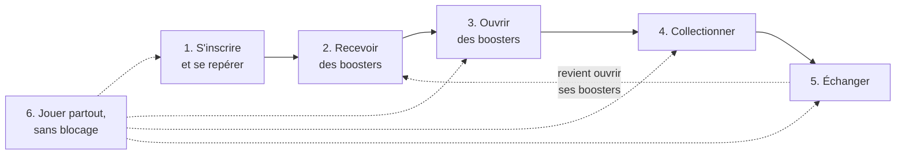

# Story map

La story map présente le backlog d’Elite Pack **dans l’ordre du parcours du joueur**, de gauche à droite, puis **par tranches de valeur**, de haut en bas. Elle complète les [personas](personas.md) et le [Jira SCRUM](https://lemeurvincent31.atlassian.net/jira/software/projects/SCRUM/boards/1/backlog), qui reste la source de vérité des statuts.

**Légende** : ✅ terminé · 🟡 en cours · ⬜ à faire · *(SP)* story points

## Colonne vertébrale du parcours

L’activité 6 est transverse : elle couvre la qualité de service (écran 800x600, gestion des erreurs) sur l’ensemble du parcours.

## Carte du joueur

| | **1. S’inscrire et se repérer** | **2. Recevoir des boosters** | **3. Ouvrir des boosters** | **4. Collectionner** | **5. Échanger** | **6. Jouer partout, sans blocage** |
| --- | --- | --- | --- | --- | --- | --- |
| **Personas** | Tous | Inès, Gérard | Tous | Thomas, Inès | Thomas | Gérard, tous |
| **Tâches** | Créer un compte · Se connecter · Voir son profil | Accumuler du stock · Suivre le compte à rebours · Profiter des événements | Choisir un sport · Ouvrir · Découvrir ses cartes · Retrouver ses ouvertures | Parcourir sa collection · Explorer les athlètes · Suivre ses objectifs | Revendre un doublon · Vendre et acheter entre joueurs | Lire l’écran en 800x600 · Comprendre une erreur |
| **Tranche 1** Squelette jouable | ✅ [SCRUM-26](https://lemeurvincent31.atlassian.net/browse/SCRUM-26) Créer un compte et se connecter *(5)* | ✅ [SCRUM-35](https://lemeurvincent31.atlassian.net/browse/SCRUM-35) Générer des boosters automatiquement *(5)* | ✅ [SCRUM-36](https://lemeurvincent31.atlassian.net/browse/SCRUM-36) Consommer les boosters gratuits *(3)* 🟡 [SCRUM-28](https://lemeurvincent31.atlassian.net/browse/SCRUM-28) Ouvrir un booster *(8)* ✅ [SCRUM-29](https://lemeurvincent31.atlassian.net/browse/SCRUM-29) Afficher une carte d’athlète *(3)* | ✅ [SCRUM-31](https://lemeurvincent31.atlassian.net/browse/SCRUM-31) Consulter ma collection *(5)* | | |
| **Tranche 2** MVP complet | ✅ [SCRUM-27](https://lemeurvincent31.atlassian.net/browse/SCRUM-27) Consulter mon profil *(2)* | ✅ [SCRUM-37](https://lemeurvincent31.atlassian.net/browse/SCRUM-37) Statistiques de boosters *(2)* ✅ [SCRUM-40](https://lemeurvincent31.atlassian.net/browse/SCRUM-40) Boosters événementiels *(3)* | 🟡 [SCRUM-39](https://lemeurvincent31.atlassian.net/browse/SCRUM-39) Boosters par sport *(5)* ✅ [SCRUM-30](https://lemeurvincent31.atlassian.net/browse/SCRUM-30) Historique des ouvertures *(2)* | ✅ [SCRUM-32](https://lemeurvincent31.atlassian.net/browse/SCRUM-32) Fiche d’un athlète *(3)* ✅ [SCRUM-38](https://lemeurvincent31.atlassian.net/browse/SCRUM-38) Catalogue multisport *(3)* | ✅ [SCRUM-33](https://lemeurvincent31.atlassian.net/browse/SCRUM-33) Revendre à la banque *(3)* ✅ [SCRUM-34](https://lemeurvincent31.atlassian.net/browse/SCRUM-34) Marché entre joueurs *(8)* | |
| **Tranche 3** Road to PROD | | | Finir l’animation de révélation (reste de SCRUM-28) et les visuels par booster (reste de SCRUM-39) | ⬜ [SCRUM-88](https://lemeurvincent31.atlassian.net/browse/SCRUM-88) Liste de souhaits — *stagiaire* *(5)* ⬜ [SCRUM-89](https://lemeurvincent31.atlassian.net/browse/SCRUM-89) Succès de collection — *US personnalisée* *(8)* | | ⬜ [SCRUM-90](https://lemeurvincent31.atlassian.net/browse/SCRUM-90) Écran 800x600 *(3)* ⬜ [SCRUM-87](https://lemeurvincent31.atlassian.net/browse/SCRUM-87) Gestion des erreurs *(8)* |

## Carte de l’administrateur

Les joueurs ne voient pas ces stories, mais elles alimentent tout le parcours : sans catalogue importé, aucun booster ne peut être ouvert.

| | **A. Alimenter le catalogue** | **B. Piloter le jeu** |
| --- | --- | --- |
| **Tâches** | Importer les athlètes · Calculer prestige et valeurs · Garder les données à jour | Suivre les indicateurs · Équilibrer l’économie · Gérer athlètes et éditions |
| **Tranche 1** Squelette jouable | ✅ [SCRUM-23](https://lemeurvincent31.atlassian.net/browse/SCRUM-23) Importer depuis TheSportsDB *(5)* ✅ [SCRUM-24](https://lemeurvincent31.atlassian.net/browse/SCRUM-24) Prestige, raretés et valeurs *(5)* | |
| **Tranche 2** MVP complet | ✅ [SCRUM-25](https://lemeurvincent31.atlassian.net/browse/SCRUM-25) Synchroniser les données *(3)* | ✅ [SCRUM-41](https://lemeurvincent31.atlassian.net/browse/SCRUM-41) Tableau de bord *(3)* ✅ [SCRUM-42](https://lemeurvincent31.atlassian.net/browse/SCRUM-42) Règles économiques *(3)* ✅ [SCRUM-43](https://lemeurvincent31.atlassian.net/browse/SCRUM-43) Athlètes et éditions *(2)* |

## Tranches de livraison

| Tranche | Objectif | Résultat attendu | Points | État |
| --- | --- | --- | ---: | --- |
| **1. Squelette jouable** | Parcourir la boucle de jeu de bout en bout, même simplement | « Je m’inscris, je reçois un booster, je l’ouvre et je vois mes cartes dans ma collection. » | 39 | Livrée, sauf l’animation de révélation |
| **2. MVP complet** | Donner une raison de revenir et d’échanger | Profil, statistiques, sports, encyclopédie, banque, marché, événements et administration | 42 | Livrée, sauf les visuels par booster |
| **3. Road to PROD** | Fiabiliser, fidéliser et ouvrir à tous les équipements | Erreurs maîtrisées, succès, liste de souhaits, affichage 800x600 | 24 | À faire |

Total : **105 points**, dont 81 livrés ou en cours de finition.

## Ce que montre la carte

- **La boucle de jeu est complète.** Les activités 1 à 5 ont toutes une story livrée dès la tranche 1 ou 2.
- **Il reste à finir la qualité de service et la fidélisation.** L’activité 6 et les objectifs de collection (tranche 3) sont vides côté livraison : c’est la priorité avant la mise en production.
- **Chaque persona a sa story en tranche 3** : Gérard avec SCRUM-90, Inès avec SCRUM-89, Thomas avec SCRUM-88.

## Faire vivre la carte

1. **À l’affinage** : toute nouvelle story est placée sous une activité et dans une tranche, et cite son persona.
2. **À la fin de chaque sprint** : mettre à jour les statuts depuis Jira, qui fait foi.
3. **À chaque nouvelle story** : l’ajouter à la carte avec sa clé `SCRUM-xx` et un lien vers Jira.
